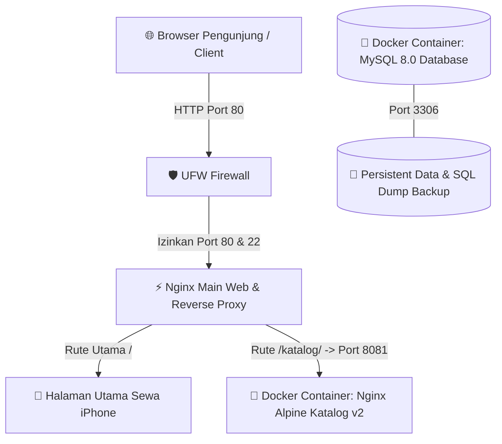

# ☁️ Cloud Infrastructure Lab — Sistem Manajemen Sewa iPhone

Repository ini berisi cetak biru infrastruktur (*Infrastructure as Code*) dan otomasi server Linux untuk layanan web serta database bisnis **Sewa iPhone**. Proyek ini dibangun untuk mensimulasikan arsitektur *production-grade* yang aman, terisolasi, dan mudah direplikasi.

---

## 🏗️ Arsitektur Sistem



---

## 🛠️ Tech Stack & Layanan yang Digunakan

* **Sistem Operasi:** Ubuntu Server LTS (Linux Administration)
* **Web Server & Reverse Proxy:** Nginx
* **Containerization & Orchestration:** Docker & Docker Compose
* **Database:** MySQL 8.0 (`rental_iphone_db`)
* **Keamanan Jaringan:** UFW (*Uncomplicated Firewall*) & SSH Key Authentication (`Ed25519`)
* **Otomasi & Backup:** Bash Scripting, `tar`, `mysqldump`, dan Cronjob

---

## 🔒 Fitur Keamanan & Otomasi yang Diterapkan

1. **Reverse Proxy & Port Isolation:** Aplikasi katalog versi baru dijalankan di dalam kontainer Docker (`Port 8081`) dan diteruskan secara internal oleh Nginx melalui rute `/katalog/`, sehingga port internal tidak terekspos langsung ke publik.
2. **Hardened SSH & Firewall:** Akses remote server diamankan menggunakan pasangan kunci kriptografi **SSH Key (`Ed25519`)** dan pembatasan lalu lintas jaringan ketat menggunakan **UFW**.
3. **Automated Backup & Disaster Recovery:** Dilengkapi skrip otomasi berbasis Bash & Cronjob untuk pencadangan direktori web (`.tar.gz`) serta ekspor database rutin (`mysqldump`) dengan penyaringan file sensitif melalui `.gitignore`.

---

## 🚀 Cara Menjalankan Infrastruktur (Quick Start)

Pastikan **Docker** dan **Docker Compose** sudah terpasang di server Linux, lalu jalankan perintah berikut:

```bash
# 1. Clone repository ini
git clone git@github.com:rizkyyyysaja/cloud-infrastructure-sewa-iphone.git
cd cloud-infrastructure-sewa-iphone

# 2. Jalankan kontainer database MySQL di latar belakang
docker compose up -d

# 3. Verifikasi status kontainer
docker ps
```

---
*Dikembangkan sebagai bagian dari portofolio praktik **Cloud Engineering & Linux System Administration**.*

